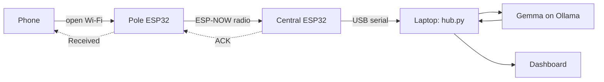
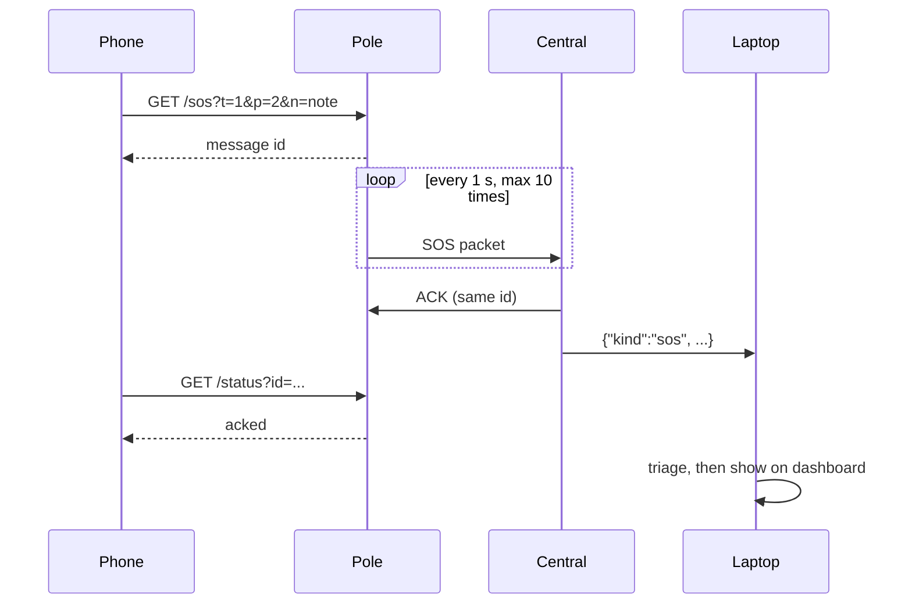
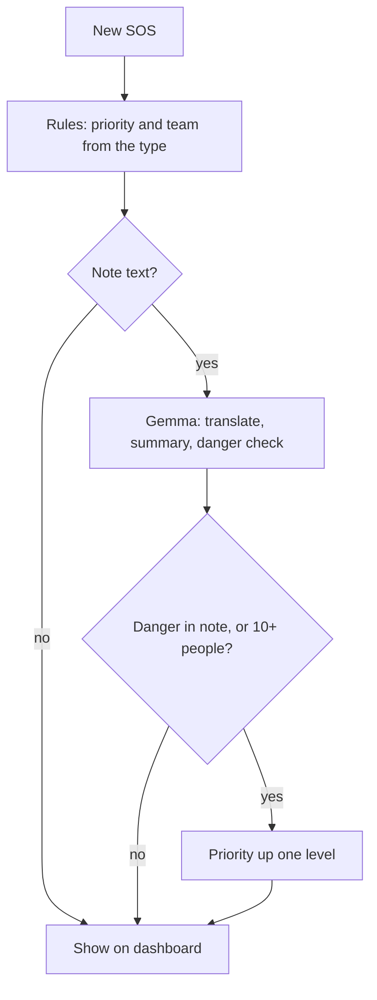

# PahadNet

PahadNet is an SOS network for disasters in the mountains. It works when the mobile network stops.

Each pole has a small ESP32 board. The board makes an open Wi-Fi network. A person connects a phone to it and sends an SOS. The phone does not need internet or an app. The message goes from the pole to a control room laptop. A local AI model on the laptop reads the message. The dashboard shows the incident, the location and the team to send.

## The problem

Floods and landslides in Himachal Pradesh often cut the mobile network. People cannot call for help. Rescue teams do not know who needs help, or where.

## How it works



1. The pole makes an open Wi-Fi network with the name `SOS-PahadNet-<node>`.
2. The phone connects. The SOS page opens automatically.
3. The person selects what happened and how many people need help. A short note is optional.
4. The pole sends the SOS to the central board by ESP-NOW. ESP-NOW does not need a router.
5. The central board sends an ACK back to the pole. The phone then shows "Control room has your SOS".
6. The central board writes one JSON line to the laptop for each event.
7. `hub.py` reads the line, gets the AI triage and updates the dashboard.

### Delivery of one SOS



The pole sends the SOS again each second until it gets an ACK. It stops after 10 tries. The central board ignores copies with an id that it already has.

### Triage



Fixed rules set the priority and the team. The model does not set them, because a small model can make mistakes. The model only reads the note. It gives an English translation, a short summary and a danger flag. If the model is not available, the rules still give a priority.

| Type | Priority | Team |
|---|---|---|
| Injured | High | Ambulance |
| Flood | High | Boat or rescue team |
| Fire | Critical | Fire brigade |
| Trapped | Critical | Rescue team |
| Food or water | Medium | Relief supplies |
| Child or elderly | High | Rescue team |
| Other | Medium | Call back and assess |

## Hardware

- 2 or more ESP32 boards. One board is the central node. All other boards are poles.
- 1 laptop with Linux, macOS or Windows.
- USB cables.

## Repository layout

| Path | Content |
|---|---|
| `pole/pole.ino` | Pole firmware: open Wi-Fi, SOS page, ESP-NOW sender |
| `central/central.ino` | Central firmware: ESP-NOW receiver, ACK, JSON to serial |
| `hub/hub.py` | Reads the central board, runs triage, serves the dashboard |
| `hub/dashboard.html` | Control room dashboard |
| `hub/nodes.json` | Name and location of each pole |
| `hub/test_triage.py` | Test for the triage rules |

## Setup

You need `arduino-cli` with the `esp32:esp32` core, Python 3 and Ollama.

### 1. Flash the central board

Connect the central board to the laptop. Find its port:

```bash
arduino-cli board list
```

Flash the firmware. Use your port in place of `/dev/ttyUSB0`:

```bash
arduino-cli compile -b esp32:esp32:esp32 central
arduino-cli upload -b esp32:esp32:esp32 -p /dev/ttyUSB0 central
```

### 2. Flash each pole

Open `pole/pole.ino`. Set a different `NODE_ID` for each pole. Then flash it:

```bash
arduino-cli compile -b esp32:esp32:esp32 pole
arduino-cli upload -b esp32:esp32:esp32 -p /dev/ttyUSB1 pole
```

### 3. Add the pole locations

Add one entry to `hub/nodes.json` for each pole. The key is the `NODE_ID`:

```json
{
  "1": {"name": "Pole 1 - Main Gate", "area": "NIT Hamirpur", "lat": 31.7084, "lon": 76.5274}
}
```

### 4. Get the AI model

Install [Ollama](https://ollama.com). Then get the model:

```bash
ollama pull gemma3:1b
```

To use a different model, change `MODEL` in `hub/hub.py`.

### 5. Start the hub

```bash
pip install pyserial
cd hub
python3 hub.py
```

The hub finds the central board on any USB port. The dashboard opens at `http://127.0.0.1:8000`. To use one port only, give the port: `python3 hub.py /dev/ttyUSB0`.

## Send a test SOS

1. Connect a phone to the `SOS-PahadNet-1` Wi-Fi network.
2. Wait for the SOS page. If it does not open, go to `http://192.168.4.1`.
3. Select the emergency type and the number of people.
4. Push **Send SOS**.
5. Look at the dashboard. The SOS shows in 1 to 2 seconds. The AI triage shows some seconds later.

## Message format

All boards use one packed struct on ESP-NOW:

| Field | Size | Content |
|---|---|---|
| `kind` | 1 byte | 1 = SOS, 2 = ACK, 3 = heartbeat |
| `node` | 2 bytes | Pole `NODE_ID` |
| `id` | 4 bytes | Random message id |
| `type` | 1 byte | 1 to 7, see the triage table |
| `people` | 1 byte | 1 = 1, 2 = 2-5, 3 = 6-10, 4 = 10+ |
| `note` | 120 bytes | Optional text |

Each pole also sends a heartbeat every 5 seconds. The dashboard uses it to show if the pole is online.

The central board writes one JSON line for each event:

```json
{"kind":"sos","node":1,"id":3508014916,"type":1,"people":2,"note":"Earthquake","rssi":-48,"mac":"b0:cb:d8:d0:25:55"}
```

## Test

```bash
cd hub
python3 test_triage.py
```

## Known limits

- All boards must use Wi-Fi channel 1. ESP-NOW and the pole Wi-Fi must be on the same channel.
- One ESP32 access point accepts a maximum of 10 phones at the same time.
- Each pole sends directly to the central board. Relay from pole to pole is not done yet.
- `gemma3:1b` does not translate Hindi and Hinglish well. `gemma4:e2b` gives better results but needs a 7.2 GB download.
- The SOS page has no login. Anyone near a pole can send an SOS.
